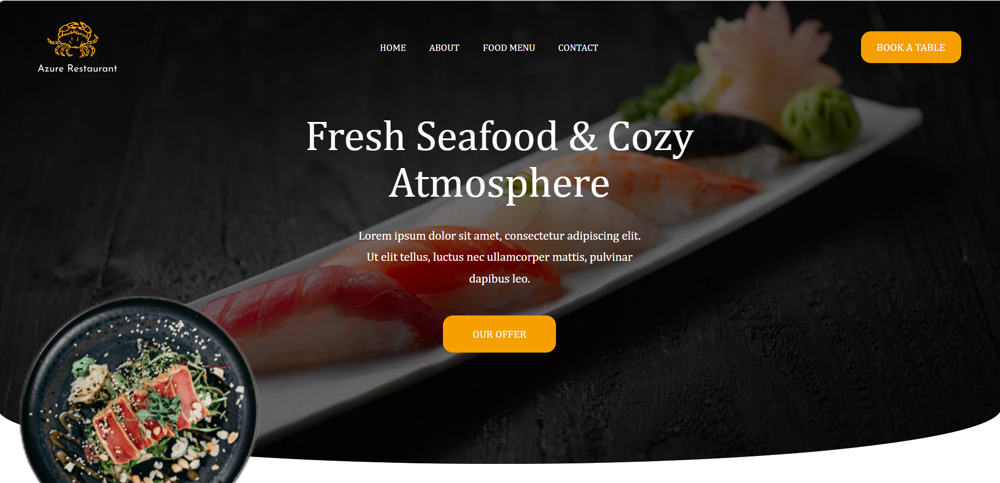

# 🐟 Seafood Restaurant Website

A responsive seafood restaurant website built using **HTML, CSS, JavaScript, and Bootstrap**. The project features a clean layout designed to present the restaurant, showcase its food menu, and provide visitors with contact information.

## 🌐 Live Demo

**[Visit Seafood Restaurant Website](https://hamadfayrouz8-gif.github.io/Seafood-Restaurant-/)**

 

## 📌 About the Project

Seafood Restaurant is a multi-page website developed as a front-end web development project. It focuses on website structure, styling, navigation, and responsive design.

## ✨ Features

- 🏠 Home page
- 👋 About page
- 🍽️ Food Menu page
- 📩 Contact page
- 📱 Responsive navigation and layout
- 🎨 Custom styling with CSS
- 🧩 Bootstrap integration
- ⚡ JavaScript for interactive elements

## 🛠️ Technologies Used

- **HTML5** — Website structure
- **CSS3** — Styling and layout
- **JavaScript** — Interactive functionality
- **Bootstrap 5** — Responsive components and layout
- **Font Awesome** — Icons

## 📂 Project Structure

```text
Seafood-Restaurant/
│
├── index.html
├── Home.html
├── About.html
├── menu.html
├── contact.html
│
├── style_home.css
├── style_about.css
├── style_menu.css
├── style_contact.css
│
├── script_home.js
├── script_about.js
├── script_menu.js
├── script_contact.js
│
├── Images/
├── bootstrap-5.3.8-dist/
└── README.md
```

## 🚀 How to Run Locally

1. Clone or download this repository.
2. Open the project folder in Visual Studio Code.
3. Open `index.html` or `Home.html` in your browser.
4. Explore the different pages using the navigation menu.

## 👩‍💻 Developer

**Fayrouz Adel Taha**

Artificial Intelligence and Data Science Student

## 📄 License

This project was created for educational and portfolio purposes.
